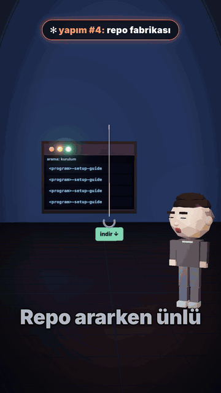
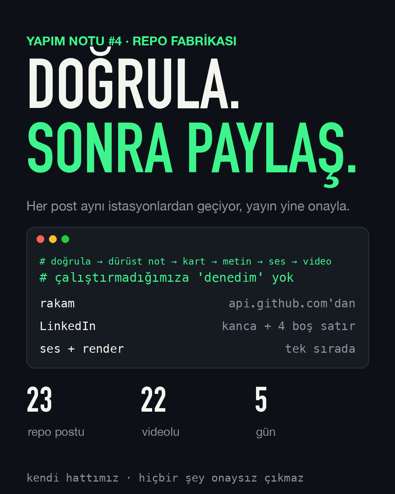

# Repo ararken ünlü programların "kurulum rehberi" gibi duran korsan yazılım yemleri çıktı.

Yapım notu #4: repo fabrikası.

31 Ekim–4 Kasım arasında 23 repo postu hazırladık, 22'sinin videosu var. Bir reponun 427 yıldızına karşılık 2 fork'u vardı, belge okununca taslakta 3 yanlış cümle çıktı, üç kısa gönderinin üçü de 280 karakteri aştı (biri 419).

Şimdi her post aynı istasyonlardan geçiyor:
→ Doğrula: yıldız, fork, lisans, açılış tarihi api.github.com'dan; yayından önce yeniden bakılıyor
→ Kart: 1080×1350, terminalde yalnız belgede geçen komutlar
→ Metin: LinkedIn/Facebook'ta ilk satır kanca + 4 görünmez boş satır; etiket sınırı Instagram 5, TikTok 8, LinkedIn 8, X 2, YouTube açıklaması en çok 15
→ Fabrika: ses (4 kapı) ve render tek sırada, paralel ses üretimi sunucuyu çökertiyor

**📊 Rakamlarla:**
• 23 repo postu
• 22 videolu
• 5 gün

**⚙️ Nasıl başlarsın:**

**📌 Kısa notlar:**
• rakam: api.github.com'dan
• LinkedIn: kanca + 4 boş satır
• ses + render: tek sırada

**✨ Öne çıkanlar:**
• yıldız/fork/lisans api.github.com'dan
• çalıştırmadığımıza "denedim" yok
• ses ve render tek sırada

Notlar için yorumlara FABRİKA yaz, DM'den göndereyim 📩

Siz paylaştığınız rakamları nereden kontrol ediyorsunuz?

[▶ Tam kalite video: video.mp4](video.mp4)

## Videoda adım adım

1. Çözümümüz bir repo fabrikası, araştırmadan videoya kadar her adım bir betik.
2. Yıldız, fork, lisans ve tarih GitHub'ın kendi arayüzünden okunuyor, yayından önce yeniden bakılıyor.
4. Her repoya aynı şablonda bir kart çiziliyor, terminalde yalnız belgede geçen komutlar yazıyor.
5. Uzun metinde ilk satır kanca, altına 4 görünmez boş satır giriyor ve devamı katlanıyor.
6. Etiket sayısı da sınırlı, çünkü bir platformda 15'i aşarsan bütün etiketler yok sayılıyor.
7. Ses ve render sırayla akıyor, çünkü paralel ses üretimi yerel sunucuyu çökertiyor.
8. Bunu bu bilgisayarda yaptık, 23 postun 22'sinin videosu var ama onaysız hiçbir şey yayınlanmıyor.

## Lisans

Bu depodaki video, kart ve metinler MIT lisanslıdır (LICENSE). Anlatılan aracın kendi lisansı kendi deposundadır.
